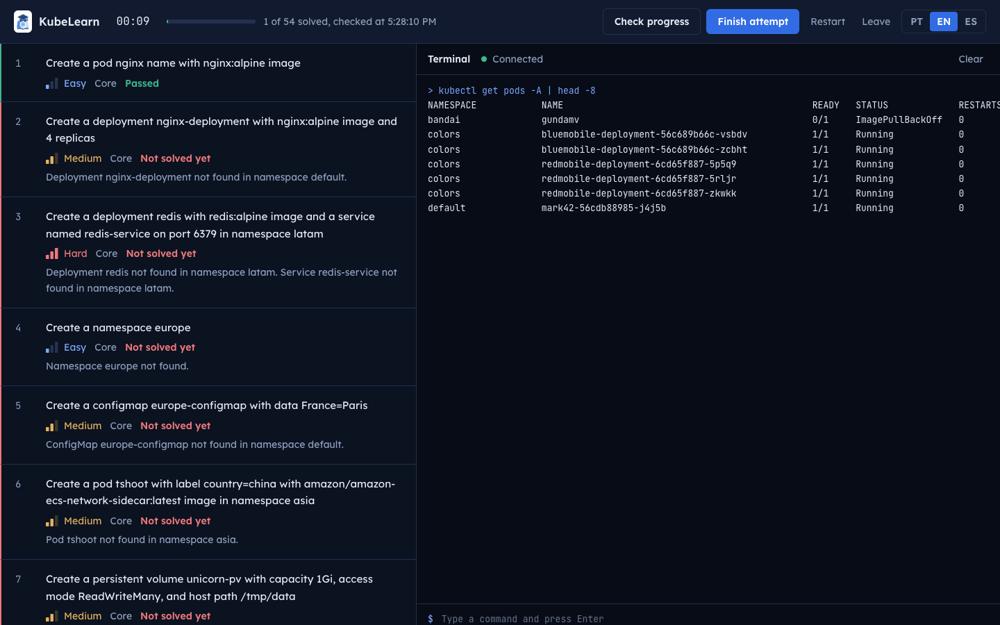
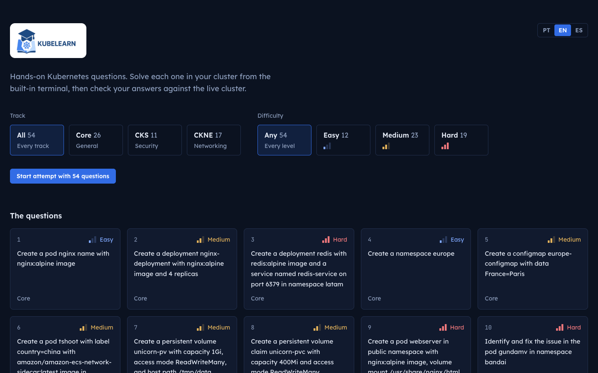

<p align="center">
  
</p>

<h1 align="center">KubeLearn</h1>

<p align="center">
  Hands-on Kubernetes practice for the CKS and CKNE exams and CKA/CKAD-level fundamentals, on a local cluster, with instant feedback.
</p>

<p align="center">
  <a href="https://github.com/miltlima/kubelearn/actions/workflows/ci.yaml"></a>
  <a href="https://github.com/miltlima/kubelearn/releases/latest"></a>
  <a href="./LICENSE"></a>
  
</p>

<p align="center">
  
</p>

## Overview

KubeLearn is a hands-on Kubernetes practice lab that runs on your machine. It provisions a local [kind](https://kind.sigs.k8s.io/) cluster, gives you 54 tasks in three tracks, and inspects the cluster to tell you which ones you solved and why the others are not solved yet.

- **Real cluster, real `kubectl`.** You solve each task in a kind cluster from the terminal built into the page.
- **Instant feedback.** Check your progress at any time; every unsolved task says what is missing, for example "Replicas is 1, expected 5".
- **Three tracks.** Core (CKA and CKAD level), CKS (security) and CKNE (networking), filterable by difficulty.
- **Three languages.** The interface and the questions are available in English, Portuguese and Spanish.
- **One binary.** Download it, run `kubelearn up` and `kubelearn`. It only needs Docker, kind and kubectl.
- **Local and free.** Nothing leaves your machine, and there is no account or time limit.

<p align="center">
  
</p>

It has two parts:

- **Backend** (Go): checks the cluster for each question and serves the in-browser terminal.
- **Frontend** (React): lists the questions, runs the attempt timer, and gives you a terminal next to them.

Releases ship both as one binary.

## Contents

- [Tracks](#tracks)
- [Prerequisites](#prerequisites)
- [Quick start](#quick-start)
- [Using the app](#using-the-app)
- [Makefile commands](#makefile-commands)
- [Backend](#backend)
- [Project structure](#project-structure)
- [Development](#development)
- [Troubleshooting](#troubleshooting)
- [Questions](#questions)
- [License](#license)

## Tracks

Pick a track on the start screen, or run every question at once.

| Track | Questions | Prepares for | Topics |
|-------|-----------|--------------|--------|
| Core | 26 | General practice (CKA/CKAD level) | Pods, deployments, services, storage, RBAC, jobs |
| CKS | 11 | Certified Kubernetes Security Specialist | Pod Security Standards, seccomp, AppArmor, security contexts, RBAC least privilege, network policies, runtime classes |
| CKNE | 17 | [Certified Kubernetes Network Engineer](https://training.linuxfoundation.org/certification/certified-kubernetes-network-engineer-ckne) | Services, DNS and CoreDNS, network policies, ingress and TLS, Gateway API |

The checks read the objects you create in the cluster. They do not send traffic or inspect nodes, so some exam topics are out of scope:

- **CKS**: audit policies, Falco, image policy webhooks, etcd encryption, CIS benchmarks, image scanning.
- **CKNE**: CNI installation and IPAM, packet-level tools (`tcpdump`, `iptables`), multi-interface pods, egress gateways, cross-cluster networking, traffic encryption, observability.

The frontend also lists a few extra CKS scenarios from these areas. They are marked "not graded".

## Prerequisites

- [Docker](https://docs.docker.com/get-docker/), running
- [kind](https://kind.sigs.k8s.io/docs/user/quick-start/#installation)
- [kubectl](https://kubernetes.io/docs/tasks/tools/)

That is all you need to run KubeLearn. Building it from source also needs Go 1.21 or newer, Node.js and make.

## Quick start

KubeLearn is a single program: it creates the lab cluster and serves the web interface, with nothing else to install.

1. Download the binary for your system from the [latest release](https://github.com/miltlima/kubelearn/releases/latest), make it executable and put it in your `PATH` as `kubelearn`. For example, on an Apple Silicon Mac:

   ```sh
   curl -L -o kubelearn https://github.com/miltlima/kubelearn/releases/latest/download/kubelearn_darwin_arm64
   chmod +x kubelearn
   sudo mv kubelearn /usr/local/bin/
   ```

   The file names follow `kubelearn_<system>_<architecture>`; see the release page for the others. On macOS, if the system refuses to open a downloaded binary, allow it with `xattr -d com.apple.quarantine /usr/local/bin/kubelearn`.

2. Create the lab cluster. This creates a three-node kind cluster named `kubelearn`, switches your kubectl context to it, and applies the lab resources:

   ```sh
   kubelearn up
   ```

3. Start KubeLearn. It opens `http://127.0.0.1:8083` in your browser:

   ```sh
   kubelearn
   ```

4. When you are done, stop it with Ctrl+C. To delete the cluster:

   ```sh
   kubelearn down
   ```

`kubelearn up` switches your kubectl context to `kind-kubelearn`. Switch back with `kubectl config use-context <name>` when you return to another cluster. KubeLearn checks your answers, and runs the terminal commands, against the current kubectl context, and warns at startup if that is not the lab cluster.

Installing the Gateway API (used by questions 51 to 54) needs internet access. Without it the rest of the lab still works; run `kubelearn up` again when you are online.

The built-in terminal runs commands through `sh`, so on Windows use KubeLearn from WSL.

### From source

```sh
git clone https://github.com/miltlima/kubelearn.git
cd kubelearn
make build          # builds bin/kubelearn with the web interface embedded
./bin/kubelearn up
./bin/kubelearn
```

## Using the app

1. **Choose the language** with the PT, EN and ES buttons. The interface and the question statements are translated; the feedback explaining why a question is not solved comes from the backend in English.
2. **Choose a track and a difficulty** on the start screen and start the attempt. Only the matching questions are asked and scored. The timer starts.
3. **Solve the questions** from the terminal on the right. Commands run on your machine against the current kubectl context.
4. **Check progress** at any time. Each question shows whether it is solved and, if not, the reason. Checking does not end the attempt.
5. **Finish the attempt** to see your score. The passing score is 85%.

Example answers for the CKS and CKNE tracks are in `manifests_examples/cks-solutions.yaml` and `manifests_examples/ckne-solutions.yaml`.

## Makefile commands

The Makefile is for working on KubeLearn itself. Run `make help` to list every target and variable.

| Target | What it does |
|--------|--------------|
| `build` | Build the complete binary, with the web interface embedded |
| `kubelearn` | Development mode: create the lab cluster, then start the backend and the interface dev server on `http://localhost:3000` |
| `stop-kubelearn` | Stop backend and frontend |
| `clean` | Stop the services and remove the backend binary and logs |
| `cluster-up`, `cluster-down` | Create or delete the lab cluster (same as `kubelearn up` and `kubelearn down`) |
| `manifests-apply` | Apply every manifest in `manifests/` |
| `manifests-delete` | Delete the resources from `manifests/` |
| `manifests-lint` | Validate the manifests with a client-side dry run |
| `gateway-api-install` | Install the Gateway API CRDs and the lab gateway class |
| `backend-build`, `backend-start`, `backend-stop` | Build, start, or stop the backend without the embedded interface |
| `frontend-install`, `frontend-start`, `frontend-stop` | Install dependencies, start, or stop the interface dev server |

Variables you can override, for example `make kubelearn LOG_DIR=/tmp/kubelearn`:

| Variable | Default | Purpose |
|----------|---------|---------|
| `KUBE_CONTEXT` | `kind-kubelearn` | kubectl context to switch to |
| `MANIFESTS_DIR` | `manifests` | Directory with the lab manifests |
| `GATEWAY_API_VERSION` | `v1.2.1` | Gateway API release to install |
| `FRONTEND_DIR` | `kubelearn-frontend` | Frontend directory |
| `BACKEND_BIN` | `bin/kubelearn` | Where the backend binary is built |
| `LOG_DIR` | `logs` | Runtime logs and PID files |

## Backend

The backend finds the cluster the same way `kubectl` does: the files in the `KUBECONFIG` environment variable, or `~/.kube/config`, using the current context. The cluster must exist before the backend starts.

### Endpoints

| Endpoint | Method | Description |
|----------|--------|-------------|
| `/catalog` | GET | List every question with its difficulty and track, without consulting the cluster |
| `/questions` | GET | Evaluate the questions and return each one with its result and feedback |
| `/finish` | GET | Evaluate the questions and return the score (percentage) and the results |
| `/start` | GET | Mark the attempt as started |
| `/setup` | POST | Create the lab cluster and apply the lab resources in the background (same as `kubelearn up`) |
| any other path | GET | The web interface, in a build that embeds it |
| `/terminal` | WebSocket | Run shell commands typed in the frontend terminal |

`/questions` and `/finish` accept two optional filters, which can be combined: `track` (`core`, `cks`, `ckne` or `all`) and `difficulty` (`easy`, `medium`, `hard` or `all`). For example, `/questions?track=cks&difficulty=hard`. They give the cluster 20 seconds to answer all checks, then return `504` instead of hanging.

### Environment variables

| Variable | Default | Purpose |
|----------|---------|---------|
| `KUBELEARN_ALLOWED_ORIGINS` | `http://localhost:3000,http://127.0.0.1:3000` | Comma-separated browser origins allowed to call the API and open the terminal, besides the interface served by KubeLearn itself |

### Security

The terminal endpoint runs any shell command it receives, with your user's permissions. For that reason the backend listens on `127.0.0.1` only and rejects requests from origins that are not in `KUBELEARN_ALLOWED_ORIGINS`. Do not expose port 8083 to a network.

## Project structure

```text
.
├── cmd                        # The kubelearn program: commands, HTTP API and terminal
├── pkg
│   ├── k8s                    # Kubernetes client setup
│   ├── lab                    # Creates and deletes the kind cluster
│   ├── resources              # Question registry and checkers
│   │   ├── easy, medium, hard # Core track, grouped by difficulty
│   │   ├── cks                # Security track
│   │   └── ckne               # Networking track
│   └── utils                  # Shared helpers and feedback reports
├── kubelearn-frontend         # React application
├── manifests                  # Lab resources, compiled into the binary
│   └── addons                 # Applied after the Gateway API is installed
├── manifests_examples         # Example answers
└── Makefile                   # Automation for the whole project
```

## Development

```sh
go test ./...                                              # backend tests
go vet ./...
npm --prefix kubelearn-frontend test -- --watchAll=false   # frontend tests
```

See [CONTRIBUTING.md](CONTRIBUTING.md) for how to contribute. To add a question:

1. Write its checker in the package of its track under `pkg/resources/`. Use `utils.Report` to collect the reasons it is not solved.
2. Append it to `Questions` in `pkg/resources/registry.go` with its track. The position defines the question number.
3. Add the objects that solve it to the fixtures in `pkg/resources/checks_test.go`.
4. If it needs lab resources, add them to a file in `manifests/`. They are compiled into the binary.
5. Add its Portuguese and Spanish statements to `kubelearn-frontend/src/i18n.js`.

Every push to `main` and every pull request runs the build, formatting checks, and tests for both parts (see `.github/workflows/ci.yaml`). Releases are built by GoReleaser when a tag is pushed (see `.github/workflows/release.yaml`).

## Troubleshooting

| Symptom | What to do |
|---------|------------|
| `kubelearn` exits at startup | It could not load a kubeconfig (`KUBECONFIG` or `~/.kube/config`). Run `kubelearn up` first. |
| Start screen shows only the Core list | The backend is not answering. In development, run `make backend-start` and check `logs/backend.log`. |
| Questions fail to load with a timeout | The cluster is not answering. Check `kubectl get nodes`. |
| Terminal shows "Connection error" | Check that the backend is running and that the frontend origin is in `KUBELEARN_ALLOWED_ORIGINS`. The dev server may pick a port other than 3000 if it is busy. |
| Questions 51 to 54 report "Gateway ... not found" after you created it | The Gateway API is not installed. Run `kubelearn up` again while online. |
| Context `kind-kubelearn` not found | The cluster does not exist. Run `kubelearn up`. |
| `kubelearn up` fails to create the cluster | Check that Docker is running and that `kind` is installed. |
| "cannot listen on 127.0.0.1:8083" | KubeLearn, or another program, is already using the port. Stop it first. |
| The dev server does not start | Run `make frontend-install` and check `logs/frontend.log`. |

In development (`make kubelearn`), backend and frontend output go to `logs/backend.log` and `logs/frontend.log`.

## Questions

### Core

| # | Difficulty | Question |
|---|------------|----------|
| 1 | Easy | Create a pod nginx name with nginx:alpine image |
| 2 | Medium | Create a deployment nginx-deployment with nginx:alpine image and 4 replicas |
| 3 | Hard | Create a deployment redis with redis:alpine image and a service named redis-service on port 6379 in namespace latam |
| 4 | Easy | Create a namespace europe |
| 5 | Medium | Create a configmap europe-configmap with data France=Paris |
| 6 | Medium | Create a pod tshoot with label country=china with amazon/amazon-ecs-network-sidecar:latest image in namespace asia |
| 7 | Medium | Create a persistent volume unicorn-pv with capacity 1Gi, access mode ReadWriteMany, and host path /tmp/data |
| 8 | Medium | Create a persistent volume claim unicorn-pvc with capacity 400Mi and access mode ReadWriteMany |
| 9 | Hard | Create a pod webserver in public namespace with nginx:alpine image, volume mount /usr/share/nginx/html, and a persistent volume claim unicorn-pvc |
| 10 | Hard | Identify and fix the issue in the pod gundamv in namespace bandai |
| 11 | Hard | Create a network policy allow-policy-colors to allow redmobile-webserver to access bluemobile-dbcache |
| 12 | Easy | Create a secret secret-colors with data color=red in colors namespace |
| 13 | Hard | Add a secret secret-purple with data singer=prince to the pod purple with image redis:alpine in colors namespace |
| 14 | Easy | Create a service account america-sa in default namespace |
| 15 | Medium | Add service account america-sa to the deployment mark42 |
| 16 | Medium | Change the replica count of the deployment mark42 to 5 |
| 17 | Medium | Create a horizontal pod autoscaler hpa-mark43 for deployment mark43 with CPU utilization 80%, min replicas 2 and max replicas 8 |
| 18 | Medium | Prevent privilege escalation in the deployment mark42 |
| 19 | Medium | Add a liveness probe to the pod mark50 with initial delay 5s, period 10s, HTTP GET, port 80, and path '/' in namespace shield |
| 20 | Easy | Create a deployment yellow-deployment with bonovoo/node-app:1.0 image and 2 replicas in namespace colors |
| 21 | Hard | Create a service yellow-service for the deployment yellow-deployment in namespace colors with port 80 and target port 3000 |
| 22 | Hard | Create an ingress ingress-colors with host yellow.com, path /yellow, and service yellow-service in namespace colors |
| 23 | Hard | Create a role apple-one with verbs get, list, watch in namespace fruits |
| 24 | Medium | Create a job job-gain with parallelism 2, completions 4, backoffLimit 3, and deadlineSeconds 40 |
| 25 | Medium | Create a cronjob cronjob-gain to run every 5 minutes with image busybox:1.28, command 'sleep 3600', and restartPolicy Never |
| 26 | Hard | Create a statefulset statefulset-gain with image busybox:1.28, command 'sleep 3600', and 3 replicas |

### CKS

| # | Difficulty | Question |
|---|------------|----------|
| 27 | Easy | Create namespaces baseline-labs and restricted-labs that enforce the baseline and the restricted Pod Security Standard |
| 28 | Medium | Create pod seccomp-default in namespace hardening with image nginx:alpine and the RuntimeDefault seccomp profile |
| 29 | Medium | Create pod apparmor-default in namespace hardening with image nginx:alpine and the AppArmor profile runtime/default on its container |
| 30 | Hard | Create pod strict-security in namespace hardening with image nginx:alpine that runs as non-root, drops all capabilities, adds only NET_BIND_SERVICE and has a read-only root filesystem |
| 31 | Hard | In namespace secure-egress create network policy restrict-egress for all pods that allows egress only to DNS on UDP port 53 and to CIDR 10.10.0.0/16 on TCP |
| 32 | Easy | Create service account no-token-sa in namespace hardening that does not automount its API token |
| 33 | Medium | In namespace audit-labs create role secret-reader that can only get the secret db-credentials, and bind it to service account auditor with role binding secret-reader-binding |
| 34 | Hard | Service account dev in namespace hardening is bound to cluster-admin. Remove that access and give it the view cluster role in namespace hardening only, with role binding dev-view |
| 35 | Hard | Deployment legacy-app in namespace hardening runs privileged and shares the host PID and network namespaces. Make it run without any of them |
| 36 | Easy | Create secret api-keys in namespace hardening with data token=s3cr3t and make it immutable |
| 37 | Medium | Create runtime class gvisor with handler runsc, and pod sandboxed in namespace hardening with image nginx:alpine that uses it |

### CKNE

| # | Difficulty | Question |
|---|------------|----------|
| 38 | Easy | Expose deployment web in namespace netlab with NodePort service web-nodeport on port 80 and node port 30080 |
| 39 | Easy | Create headless service web-headless in namespace netlab for pods app=web on port 80 |
| 40 | Easy | Create service external-api in namespace netlab of type ExternalName pointing to api.example.com |
| 41 | Medium | Create service web-sticky in namespace netlab for pods app=web on port 80 with client IP session affinity and a 600 second timeout |
| 42 | Medium | Create NodePort service web-local in namespace netlab for pods app=web on port 80 that sends external traffic only to pods on the node that received it |
| 43 | Medium | Add an HTTP readiness probe on path / and port 80 to deployment web in namespace netlab, so only ready pods receive traffic |
| 44 | Hard | Customize CoreDNS with a rewrite rule so that legacy.internal resolves to service web in namespace netlab |
| 45 | Medium | Create pod dns-custom in namespace netlab with image nginx:alpine that ignores cluster DNS and uses nameserver 1.1.1.1, search domain netlab.svc.cluster.local and option ndots 2 |
| 46 | Easy | Create network policy default-deny-ingress in namespace netlab that blocks all incoming traffic to every pod |
| 47 | Hard | Create network policy api-from-frontend in namespace netlab so pods app=api accept TCP 8080 only from namespaces labelled team=frontend |
| 48 | Hard | Create network policy web-egress-internet in namespace netlab so pods app=web can reach any address on TCP 443 except 10.0.0.0/8 |
| 49 | Medium | Create TLS secret shop-tls in namespace netlab with a self-signed certificate for shop.example.com |
| 50 | Medium | Create ingress shop in namespace netlab with ingress class nginx that sends host shop.example.com path / to service web on port 80, with TLS from secret shop-tls |
| 51 | Medium | Create gateway web-gateway in namespace netlab with gateway class kubelearn and an HTTP listener on port 80 |
| 52 | Hard | Create HTTP route web-route in namespace netlab on gateway web-gateway for host shop.example.com, sending path prefix /api to service api on port 8080 and everything else to service web on port 80 |
| 53 | Hard | Create HTTP route web-canary in namespace netlab on gateway web-gateway for host canary.example.com that sends 90% of the traffic to service web and 10% to service web-v2, both on port 80 |
| 54 | Hard | Add an HTTPS listener on port 443 for host shop.example.com to gateway web-gateway in namespace netlab, terminating TLS with secret shop-tls |

## License

Apache License 2.0. See [LICENSE](LICENSE).
